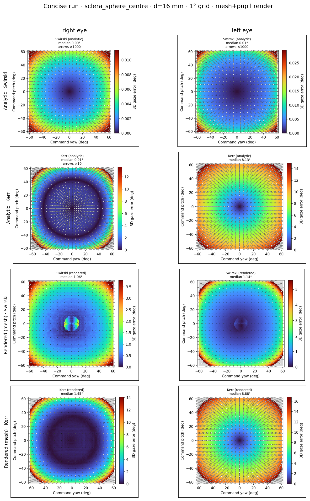

# Physical eye simulation — Kerr vs Swirski (conicoid)

Lightweight, GitHub-friendly package for comparing **Kerr** nested gaze angles
with the **conicoid / Swirski** sphere fit on a physical-eye–inspired pupil
simulation. Defaults match the Pogona (bearded dragon) MRI landmarks and the
PETS paper camera (3.7 mm lens on OV5647 @ 640×480 → **f ≈ 652.6 px**).

Large render dumps (videos, frame sequences, MRI meshes) are **not** stored
here; archive them separately (e.g. Zenodo). This folder is the **code
savepoint** plus one reference heatmap from the Pogona study.

## Why this exists

Most laboratory eye-tracking pipelines (including the historical PETS path)
convert pupil ellipses to gaze with **Kerr’s** nested `arcsin` mapping: cheap,
approachable, and good enough for many ethological questions. We wanted to
know whether that residual was acceptable for our work.

On a physical-eye simulation with known ground-truth gaze:

- **Kerr** leaves a **few degrees** of systematic error (pivot- and
  distance-dependent; often ~1–9° median on analytic ellipses).
- **Swirski / conicoid** recovers gaze to **~0.005°** on exact (analytic)
  ellipses, and about **~1°** when ellipses come from rendered images and a
  contour fit.

That gap is large enough that **Swirski is the route we trust** for
quantitative gaze; Kerr remains useful as a sanity check and for tools that
still consume `k_phi` / `k_theta`. This package makes that comparison
reproducible with **tweakable camera and eye knobs**.

Reference plate from the Pogona MRI-based study (analytic + mesh render,
sclera-sphere pivot, 16 mm, 1° grid):



(`examples/kerr_vs_swirski_pogona.pdf` is the same figure.)

## Analytic vs Blender

| Mode | What you get | Needs |
|------|----------------|-------|
| **`analytic` (default)** | Exact pinhole image of a circular pupil → Kerr & Swirski heatmaps | Python + repo `src/` |
| **`blender`** | Same scoring on ellipses fitted from EEVEE frames of a **lightweight** sphere+pupil eye | Blender installed |

Analytic answers: *“If the ellipse were perfect, which method is right?”*  
Blender answers: *“What does imaging + fitting (and optional occlusion) cost?”*

## Quick start (analytic)

```bash
# from the PETS repo root
PYTHONPATH=.:src python -m physical_eye_simulation.run

# custom camera / geometry
PYTHONPATH=.:src python -m physical_eye_simulation.run \
  --lens-mm 3.7 --sensor-width-mm 3.6288 --width 640 --height 480 \
  --distance-mm 16 --pivot sclera_sphere_centre \
  --sides right left --step-deg 1 \
  --out outputs/physical_eye_simulation_runs/my_cam
```

Defaults live in [`config_default.yaml`](config_default.yaml). Geometry defaults
are Pogona landmarks in [`geometry/`](geometry/).

Outputs per scenario: `ground_truth_analytic.csv`, `eval_analytic/` heatmaps
and `summary.csv`.

## Optional Blender path

```bash
PYTHONPATH=.:src python -m physical_eye_simulation.run --mode blender --step-deg 5
```

This builds a **lightweight analytical eye** (sclera sphere + black pupil disc,
no MRI mesh) via
[`blender_build_analytic_eye.py`](blender_build_analytic_eye.py), renders with
EEVEE, fits ellipses, and scores Kerr / Swirski. Use a coarser `--step-deg`
for smoke tests; 1° grids are slow.

### Using your own MRI / landmarks (like the Pogona annotation)

1. Prepare eye surface meshes and place landmarks in Blender (`fovea_pit`,
   `lens_centre`, `pupil_disc`, `eye_centre`; optical axis = fovea → lens).
2. Export geometry JSON in the same schema as `geometry/eye_geometry_*.json`
   (or adapt `read_annotations.py` to your object names).
3. Point `--geometry-dir` at that folder and re-run `--mode analytic` or
   `--mode blender`.

MRI STLs and multi‑MB annotation `.blend` files stay **out of this package**;
keep them locally or on Zenodo.

## Package layout

```
physical_eye_simulation/
  README.md
  run.py / config_default.yaml
  geometry/eye_geometry_{left,right}.json
  examples/kerr_vs_swirski_pogona.{png,pdf}
  camera_model.py
  analytic_projection.py
  evaluate.py
  blender_build_analytic_eye.py   # lightweight sphere+pupil
  blender_*.py / render_and_fit.py / read_annotations.py
```

## Citations

- **Safaee-Rad et al. (1992)** — circular feature unprojection / conicoid
  (the “Reza” foundation for recovering a 3D circle from its image ellipse):  
  Safaee-Rad, R., Tchoukanov, I., Smith, K. C., & Benhabib, B. (1992).
  Three-dimensional location estimation of circular features for machine
  vision. *IEEE Transactions on Instrumentation and Measurement*, *41*(3),
  312–317. https://doi.org/10.1109/19.139454

- **Świrski & Dodgson (2013)** — multi-frame pupil-on-sphere fit used here
  (via the PETS `conicoid` port of singleeyefitter):  
  Świrski, Ł., & Dodgson, N. A. (2013). A fully-automatic, temporal approach
  to single camera, glint-free 3D eye model fitting. *Proceedings of the IEEE
  Conference on Computer Vision and Pattern Recognition Workshops* (PETMEI).  
  Implementation reference: https://github.com/LeszekSwirski/singleeyefitter

- **Kerr nested-angle mapping** — the production transform in PETS
  (`BlockSync.kerr`): horizontal then vertical `arcsin` of pupil-centre offsets
  from a reference, using an internal length scale. It is the approachable
  baseline most of our ethological pipelines used before the conicoid path;
  see the PETS preprocessing docs and `BlockSync_class.kerr` for the exact
  formulae used in this repository.

## Tests

```bash
PYTHONPATH=.:src pytest tests/test_eye_simulation_projection.py -q
```
